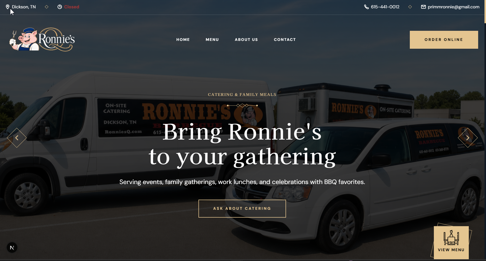

# Ronnie's Q – Next.js Restaurant Website

Ronnie's Q is a modern, responsive restaurant website created for a family-owned barbecue restaurant in Dickson, Tennessee. Built with Next.js, TypeScript, Supabase, and custom CSS, the site combines a polished restaurant experience with dynamic business information, an interactive menu, and a scalable foundation for future administrative tools.

This project showcases my growth as a full-stack web developer by combining front-end design, reusable React architecture, database-driven content, responsive development, and production deployment.

## Table of contents

- [Overview](#overview)
  - [Screenshot](#screenshot)
  - [Links](#links)
- [My process](#my-process)
  - [Built with](#built-with)
  - [Growth & Insights](#growth--insights)
- [Author](#author)


## Overview

Ronnie's Q is a redesigned website for a real family-owned barbecue restaurant. The goal of the project was to create a professional digital experience that reflects the restaurant's history and personality while also making important information easy for customers to access.

The public website includes a responsive homepage, restaurant history, full menu, contact options, operating hours, special notices, and Supabase-powered restaurant data.

Key features include:

• Dynamic restaurant hours with live Open / Closed status 🕒

• Special-date hours and temporary closure support 📅

• Customer announcement and restaurant notice system 📢

• Full interactive restaurant menu 🍖

• Menu categories, pricing, images, and item customization options

• Supabase-powered menu and restaurant information

• Responsive navigation and mobile-friendly layouts 📱

• About page featuring Ronnie's Q history, awards, memories, and restaurant photography

• Contact and inquiry forms powered by Formspree ✉️

• Automatic fallback content if public Supabase data is unavailable

• Production deployment through Vercel

• Administrative dashboard and content-management tools currently under development


### Screenshot



> The screenshot above can be added to the `public` folder as `ronniesq-screenshot.png`.


### Links

- Live Site URL: [Ronnie's Q]([YOUR_VERCEL_URL])
- GitHub Repository: [Ronnie's Q GitHub](https://github.com/Lit-97/ronniesq-new)


## My process

I began by planning the website around both the customer's experience and the restaurant's real operational needs. Rather than creating a static restaurant template, I structured the project so restaurant information could eventually be managed without repeatedly editing the website's source code.

Then I:

1. Set up the project using Next.js, React, and TypeScript.

2. Built reusable React components for the header, hero section, restaurant information, services, featured menu content, testimonials, contact sections, and footer.

3. Created a responsive multi-page structure for the Home, About, Menu, and Contact pages.

4. Designed the website using custom CSS with Ronnie's Q's blue, cream, gold, and charcoal visual identity.

5. Built a complete interactive menu with categories, menu images, pricing, customization options, and conditional item selections.

6. Connected the public website to Supabase for menu information, restaurant hours, announcements, special dates, and other dynamic content.

7. Added fallback restaurant data so important public information can still display if the database is temporarily unavailable.

8. Created a live restaurant-status system that automatically displays whether Ronnie's Q is currently Open or Closed based on the restaurant's configured hours.

9. Added support for special operating hours, temporary closures, and customer announcements.

10. Integrated Formspree for website contact and restaurant inquiry submissions.

11. Optimized the site for desktop, tablet, and mobile layouts.

12. Separated unfinished administrative functionality from the public production repository and deployment.

13. Deployed the production website through GitHub and Vercel.


### Built with

- Next.js 16

- React 19

- TypeScript

- Custom CSS

- Supabase (Database & public restaurant content)

- Formspree (Contact form submissions)

- Vercel (Deployment & Hosting)

- Git & GitHub (Version Control)

- Next.js App Router

- Responsive Web Design

- Dynamic restaurant hours and special-date logic

- Interactive menu customization system

- Optimized restaurant photography and media assets


### Growth & Insights 🌱

- Building a real-world website around the operational needs of an active restaurant

- Structuring a larger Next.js application with reusable components and multiple pages

- Creating strongly typed data structures with TypeScript

- Integrating Supabase with a production Next.js application

- Working with Row Level Security and public database access for customer-facing content

- Building dynamic Open / Closed restaurant status based on weekly hours and special-date overrides

- Designing a complex restaurant menu with categories, item options, conditional selections, and pricing

- Creating fallback systems so critical restaurant information remains available if external data cannot be loaded

- Separating public application code from unfinished administrative and private functionality

- Managing environment variables safely between local development and Vercel

- Debugging production build and deployment issues

- Testing a production-only version of the application before publishing it to GitHub

- Managing Git tracking so private administrative code and environment files remain outside the public repository

- Deploying and maintaining a production Next.js application with GitHub and Vercel


### Development & Security Notes

The public Ronnie's Q website uses the following client-safe environment variables:

```env
NEXT_PUBLIC_SUPABASE_URL=
NEXT_PUBLIC_SUPABASE_PUBLISHABLE_KEY=
```

Actual environment-variable values are not stored in this repository.

The administrative dashboard and management system are still under development. Administrative routes, authentication configuration, privileged Supabase access, and private environment variables are intentionally excluded from the public repository and production website.


## Author

- Website - [My Portfolio](https://litney-portfolio.vercel.app/)
- GitHub - [@Lit-97](https://github.com/Lit-97)
